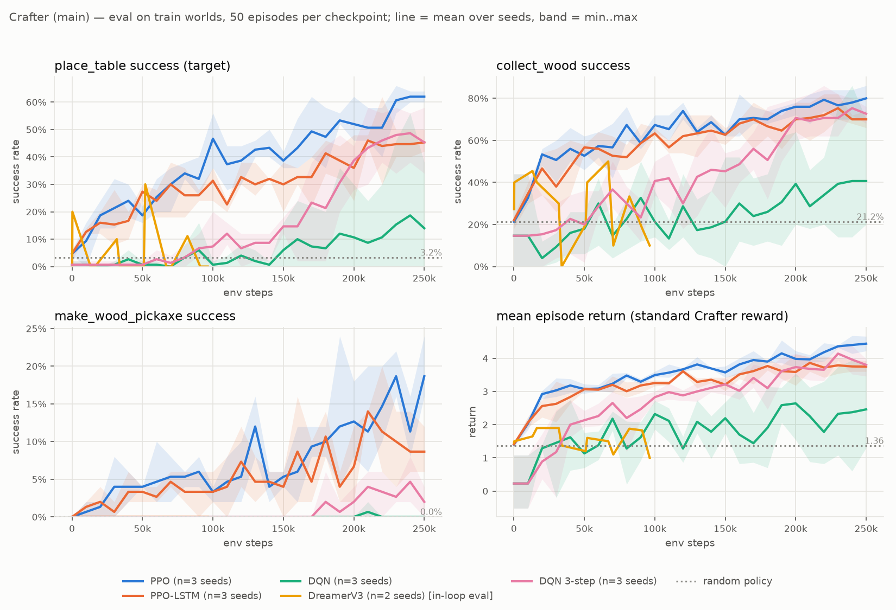

# DQN vs PPO vs PPO-LSTM vs DreamerV3 on Crafter

ECE1508 reinforcement learning course project. We compare four reinforcement-learning
methods on **Crafter**, a 2D Minecraft-like game with sparse rewards and a partial view of
the world, under the same budget of game steps and the same evaluation code.

**Status (2026-11-10):** preliminary results exist for all three research questions.
Final experiments run Nov 16 – Dec 4; results freeze on Dec 6.
Full plan, decisions and run log: [PLAN.md](PLAN.md).

## Research questions
- **RQ1, learning efficiency:** how fast does each method learn (success rate and return vs. game steps)?
- **RQ2, generalization:** how much worse does each method do on game worlds it never trained on?
- **RQ3, world-model reliability:** how accurate are DreamerV3's predicted rewards and episode
  endings as it imagines further ahead?

## Key terms
- **Game world.** Crafter generates each 64×64 map (terrain, trees, water, caves, animals)
  from a number called the *world seed*. The same world seed always gives the same map.
  We train on **50 worlds** (seeds 0–49) and also test on **100 unseen worlds** (10000–10099).
- **Task.** The agent must **place a crafting table**: chop trees until it holds 2 wood, then
  use the place-table action facing an empty grass, sand or path tile. Success = it happens at
  least once in an episode. Random play succeeds 2–4.5% of the time.
- **Reward.** The standard Crafter reward: +1 the first time each of 22 achievements happens in
  an episode (placing a table is one of them), ±0.1 for health changes. An ablation rewards
  only the table.
- **Run seed.** A separate random seed for each training run. It sets the network's starting
  weights, the order of worlds and the random exploratory moves. "3 seeds" = three independent
  runs of the same method, to tell real results from luck.

## The four methods
| Method | Family | In one sentence | Implementation here |
|---|---|---|---|
| **DQN** | value-based | Learns a score for each action (expected future reward) from a memory of past moves, and picks the best one. | Stable-Baselines3; 3-step-return variant as second try |
| **PPO** | policy-based | Learns action probabilities directly, with small, clipped updates from fresh play. | Stable-Baselines3, 8 games in parallel, no memory |
| **PPO-LSTM** | policy-based + memory | PPO plus an LSTM memory of earlier frames (the agent sees only a small patch of the map). | sb3-contrib RecurrentPPO |
| **DreamerV3** | model-based | Learns a world model (a learned simulator), then trains its policy on imagined play. | Official authors' code, smallest size (~0.7M parameters), CPU |

## What has been done
1. **Setup and baselines.**
   - One shared environment wrapper, `rlproj/envs/crafter_task.py`, with the world pools, the target, the two reward modes and determinism tests.
   - A random-policy baseline: 400 episodes, which is how we picked the target.
   - A speed test: PyTorch trains PPO 4.8× faster on the M2 Max GPU (MPS) than on the CPU.
2. **Pipeline.** Every method writes a checkpoint every 10k steps. Checkpoints are scored by one shared evaluation harness:
   - fixed worlds, 50 episodes on training worlds and 50 on unseen worlds;
   - 95% confidence intervals;
   - byte-identical results on a re-run.

   Every run records its git commit, config and hardware.
3. **Experiments (preliminary).**
   - PPO, PPO-LSTM, DQN and DQN 3-step: 250k steps × 3 seeds each.
   - DreamerV3: 100k steps × 3 seeds, plus one run each with 2× and 4× training updates.
   - A reward-sparsity ablation for PPO and for DreamerV3 with 4× updates (3 seeds each).
   - PPO at 1M steps, to compare with the Crafter paper.
   - World-model error vs. imagination horizon for every DreamerV3 run.

## Preliminary results
Success = placing a table. Final = last two checkpoints of each of 3 seeds, pooled
(300 episodes per world set). Brackets = 95% confidence interval.

| Method | Seeds | Steps | Training worlds | Unseen worlds | Gap |
|---|---|---|---|---|---|
| Random policy | – | – | 2.0% | 4.5% | – |
| **PPO** | 3 | 250k | **62.0%** [56–67] | **52.0%** [46–58] | +10 pts |
| PPO-LSTM | 3 | 250k | 45.0% [40–51] | 40.3% [35–46] | +5 pts |
| DQN | 3 | 250k | 16.3% [13–21] (learns on 1 of 3 seeds) | 17.7% [14–22] | ≈0 |
| DQN, 3-step returns | 3 | 250k | 47.0% [41–53] | 37.0% [32–43] | +10 pts |
| DreamerV3 (smallest) | 3 | 100k | 4.7% [2–9] | 2.7% [1–7] | – |
| DreamerV3, 4× updates | 1 | 100k | 0% [0–7] | 0% [0–7] | – |
| PPO, sparse reward (ablation) | 3 | 250k | 96.0% [93–98] | 82.3% [78–86] | +14 pts |
| DreamerV3, 4× updates, sparse reward (ablation) | 3 | 100k | 17.7% [14–22] | 17.0% [13–22] | ≈0 |

Rows pool the last two checkpoints over all seeds (3 seeds: 300 episodes per world set), except
the two older DreamerV3 runs, which have only their final checkpoint scored ("smallest": 150
episodes per world set over 3 seeds; standard-reward 4× updates: 50, one seed).

- **RQ1:** PPO learns fastest. Memory (PPO-LSTM) does not help at this budget. Plain DQN is
  unreliable across seeds; 3-step returns fix that. DreamerV3 at this size stays at random level
  with the default number of updates. With 4× updates it does learn (it collects saplings 97% of
  the time vs. 51% for random play, wood 41% vs. 21%) but goes for these easy achievements and
  never places a table. When it is rewarded only for the table (sparse reward), it does learn
  the task, but late: all 3 seeds stay near random level until 80–90k steps, then reach
  25% / 23% (training / unseen worlds) at 100k ([figure](figures/ablation_sparse_dreamerv3_r128.png)).
  PPO with the same sparse reward is at 49% / 39% at 100k (3 seeds each).
- **RQ2:** agents that learn do 5–10 points worse on unseen worlds. Both curves match until
  ~100k steps; after that, training-world success rises faster. Unseen-world success still
  rises with more training (PPO at 1M: 94% training, 87% unseen).
- **RQ3:** DreamerV3's world model learns the images and the average reward, but never predicts
  the +1 reward for unlocking an achievement, even while watching real frames (3 of 3 seeds).
  Its policy learns only from those predictions, so it gets no signal for the task. With 4×
  updates the world model catches 30% of unlocks while watching and 10–60% while imagining up
  to 16 steps ahead ([figure](figures/main_wm_error_dreamerv3_r128.png)), and that is when its
  policy starts to learn. With the sparse reward the reward predictor again misses the table
  reward (1 of 15 caught on seed 1, none on seeds 0 and 2), yet the policy still learns the
  table. Our explanation: DreamerV3's value network is also trained on the real rewards stored
  in replay (the `repval` loss in `dreamerv3/agent.py`), so the reward reaches the policy through
  the value network instead. A check on the saved checkpoints supports this but does not prove
  it ([figure](figures/ablation_sparse_value_check_dreamerv3_r128.png)): at 100k steps, on all
  3 seeds, the value network scores states higher in games that go on to place a table
  (+17% to +56% vs games that don't) and when the agent holds wood (+17% to +98% vs no wood);
  at 50k and 90k neither shows. It does not rise in the last 40 steps before a table, but with
  DreamerV3's discount (0.997 per step) even a perfect value network would rise only ~11% there.
  The values are small (0.02–0.1). A firm test is one run with the `repval` loss turned off.
- **Against published work:** scored the way the Crafter paper scores it (success over all
  training episodes), our PPO at 1M steps gets 86% / 73% / 40% on collect wood / place table /
  make wood pickaxe vs. the paper's 83% / 66% / 21%. Our random baseline also matches the paper's.



More figures: [generalization](figures/main_generalization.png),
[reward ablation, PPO](figures/ablation_sparse_ppo_cnn.png),
[reward ablation, DreamerV3](figures/ablation_sparse_dreamerv3_r128.png),
[world-model error](figures/main_wm_error.png). Full table: [results/main/summary.md](results/main/summary.md).

## Problems found and fixed
- **No DreamerV3 learning curves:** upstream keeps only its latest checkpoint. Our launcher now
  also saves the agent every 10k game steps, and every one is scored by the shared harness
  (first used for the sparse-reward run). The first version also saved a near-copy 8 steps after
  the 100k checkpoint, which would have counted the end of training twice in "last 2
  checkpoints"; it now skips that, and the copy was left out of the results.
- **Crafter was not reproducible:** the same world seed and actions could give different games.
  The cause was Python set ordering when despawning creatures. Our wrapper fixes it, and tests cover it.
- **World generation was the bottleneck:** 0.5 s per reset. Caching each world per seed cut it
  to ~1 ms (env speed 351 → 6,181 steps/s with 8 processes) with identical results.
- **Upstream DreamerV3 dropped its report metrics:** we added a documented patch that measures
  reward/continuation error per imagination step (`third_party/PATCHES.md`).
- **Evaluation noise:** 20 episodes per checkpoint gave intervals like 1–24%, so we use 50.

## Current problems and limitations
- **DreamerV3 is too small and too slow here.** On this laptop it runs only on the CPU, so we use
  the smallest model (~0.7M parameters) and few training updates per game step (train ratio 32,
  vs. 512 in the authors' Crafter setting with a much larger model). At ratio 32 (3 seeds) and
  ratio 64 (1 seed) its policy stays at random level.
- **With 4× updates, DreamerV3 learns the wrong things.** At ratio 128 (1 seed) the world model
  finally sees the unlock rewards and the policy clearly learns, but it goes for the easiest
  +1s: saplings (97% vs. 51% for random play), wood, water, cows. It never places a table
  (0 of 100 eval episodes), and its table rate during training falls from 7.6% in the first
  20k steps to 0% in the last 20k. With the standard reward every achievement is worth the same
  +1, and placing a table needs a longer chain (two wood, then the right tile), so the cheap
  ones win at this budget. This is our reading of the numbers, not yet tested; the sparse-reward
  run below tests it.
- **DreamerV3 compute grows with the update ratio.** Training time grows roughly in proportion
  to the ratio: 100k steps take ~1.5 h at ratio 32, 2.35 h at ratio 64 and 4.6 h at ratio 128
  (~6 game steps/s; sparse-reward seeds 1 and 2, each run alone, took 4.65 h and 4.63 h).
  Three seeds at ratio 128 are ~14 h, and each further DreamerV3 experiment costs the same
  again. The authors' ratio 512 would be roughly 18 h per run at this size (an extrapolation,
  not measured).
- **A bigger DreamerV3 is out of reach on this laptop.** The next size up (size12m, 10.5M
  parameters vs 0.69M) trains ~3.9× slower at ratio 128 (1.5 vs 6 game steps/s, measured in a
  short run on the idle laptop), so 100k steps would take ~18 h per seed (projected). It only
  makes sense on a GPU.
- **Only one machine can run DreamerV3.** Its runs peak at 10–13 GB of memory (9.9 GB at
  ratio 32, 10.5–13.3 GB at ratio 128), more than the iMac's 8 GB, so all DreamerV3 runs share the
  M2 Max with the Stage 4 runs of the other methods, one job at a time.
- **Few DreamerV3 seeds.** Ratio 64 and the standard-reward ratio-128 run have one seed each, so
  their differences from ratio 32 are not yet confirmed across seeds.
- **DreamerV3 learns the table too late in 100k steps.** With the sparse reward all 3 seeds
  reach 18–30% only at the last checkpoint, so "final" (the last two checkpoints, 90k and 100k)
  is 18% / 17%, and we don't know where it would level off. A longer run would tell (our guess:
  higher).
- **DreamerV3's reward predictor misses the rewards that matter.** Even when the policy learns
  the table, the world model never predicts the table reward (sparse run). RQ3 has to report
  this; the value-network explanation above is supported by a check but not yet proven.
- **DreamerV3 evaluation gaps (older runs).** The runs before the sparse-reward run have only
  their latest checkpoint scored by the harness (70k–97k of 100k steps), and their learning
  curves come from the in-loop evaluation, which plays only ~10 episodes per world set per round
  and is too noisy to say when learning starts. Re-running them with step checkpoints fixes this.
- **RQ3 data:** measured on the agent's replay memory, not on a separate set of unseen-world games.
- **Timing:** all numbers are from one laptop (MacBook Pro M2 Max, 32 GB); a faster machine,
  especially one with an NVIDIA GPU, should be faster. The model-free methods were re-timed alone
  on the idle laptop (50k steps each, training only; [table](results/timing/summary.md)): per
  10k steps PPO 6.2 s, PPO-LSTM 16 s, DQN and DQN 3-step 28 s (on the Mac GPU). The older
  overnight timings were 1.4–2× slower because several jobs shared the laptop. The DreamerV3
  ratio-128 runs ran alone, except sparse-reward seed 0 (partly on battery after a power
  outage).
- **Small study:** default (rl-zoo) settings, no tuning, 3 seeds, 250k steps.

## Next steps
1. **DreamerV3:**
   - The sparse-reward runs (3 seeds) learn the table only at the very end. Next: one longer
     run (200k steps, ~9.5 h) to see where it levels off.
   - Re-run the standard-reward ratio-128 run with step checkpoints, so both reward settings
     have harness learning curves.
   - Confirm how the table reward reaches the policy: one sparse-reward run with the `repval`
     loss turned off (~4.6 h).
   - Look for an NVIDIA GPU (university cluster or cloud), which DreamerV3 is built for. The
     next model size (size12m) needs ~18 h per 100k steps on this laptop.
2. **Measurement:**
   - Collect separate unseen-world games for RQ3.
3. **Final experiments (Nov 16 – Dec 4):**
   - PPO, PPO-LSTM and DQN at 1M steps × 3 seeds: ~0.2 h / 0.45 h / 0.8 h of training per
     seed on this laptop (projected from the timing runs; evaluation adds to this).
   - Decide whether DQN 3-step becomes our main DQN.
4. **Communication:** send the TA update, then build the presentation figures from frozen results.

## Repository layout
- `rlproj/`: shared code.
  - `envs/`: the Crafter wrapper.
  - `eval/`: the harness and metrics.
  - `adapters/`: one interface over all four methods.
  - `utils/`: config, metadata and CSV schemas.
- `scripts/`: training, evaluation and analysis entry points.
- `configs/`: one YAML file per experiment.
- `plots/`: figures and summary tables.
- `results/`: small CSV and JSON outputs (committed).
- `figures/`: plots.
- `runs/`: checkpoints and logs (not committed).
- `tests/`: 30 unit tests.
- `third_party/`: the pinned DreamerV3 submodule; every local change is listed in `PATCHES.md`.

## Setup (macOS arm64, Python 3.11)
```bash
brew install python@3.11
git submodule update --init
git -C third_party/dreamerv3 apply ../patches/dreamerv3-report-wm-horizon.patch
/opt/homebrew/bin/python3.11 -m venv .venv-sb3
.venv-sb3/bin/pip install -r requirements-sb3.lock
/opt/homebrew/bin/python3.11 -m venv .venv-dreamer
.venv-dreamer/bin/pip install -r requirements-dreamer.lock
```

## Reproduce
```bash
# Tests
.venv-sb3/bin/python -m unittest discover -s tests -t .
# Random baseline and device benchmark
.venv-sb3/bin/python scripts/random_baseline.py --config configs/stage0_random.yaml
.venv-sb3/bin/python scripts/bench_device.py --config configs/stage0_bench_device.yaml
# Model-free methods: train, then evaluate every checkpoint
# (also ppo_lstm_250k, dqn_250k, dqn_nstep3_250k, ablation_sparse_ppo_cnn_250k, ppo_cnn_1m)
for s in 0 1 2; do .venv-sb3/bin/python scripts/train_sb3.py --config configs/ppo_cnn_250k.yaml --seed $s; done
# DreamerV3: train, convert logs, world-model error, harness eval of the last checkpoint
C=configs/dreamer_size1m_r32_100k.yaml
.venv-dreamer/bin/python scripts/train_dreamer.py --config $C --seed 0
.venv-sb3/bin/python scripts/dreamer_results.py --config $C --seed 0
.venv-dreamer/bin/python scripts/wm_eval.py --config $C --seed 0
.venv-dreamer/bin/python scripts/eval_dreamer.py --config $C --seed 0
# Tables and figures
.venv-sb3/bin/python plots/summarize_results.py --exp main
.venv-sb3/bin/python plots/plot_learning_curves.py --exp main
.venv-sb3/bin/python plots/plot_generalization.py --exp main
.venv-sb3/bin/python plots/plot_wm_error.py --exp main
.venv-sb3/bin/python plots/plot_ablation.py --method ppo_cnn
```

## Acknowledgements
AI coding assistants were used to help with parts of the implementation.

## References
- Hafner, *Benchmarking the Spectrum of Agent Capabilities* (Crafter), arXiv:2109.06780.
- Mnih et al., *Human-level control through deep reinforcement learning* (DQN), Nature 2015.
- Schulman et al., *Proximal Policy Optimization Algorithms*, arXiv:1707.06347.
- Hafner et al., *Mastering Diverse Domains through World Models* (DreamerV3), arXiv:2301.04104.
- Raffin et al., *Stable-Baselines3*, JMLR 2021.
