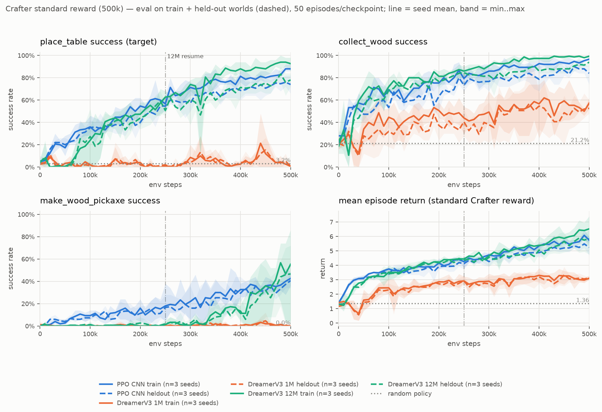

# DQN vs PPO vs PPO-LSTM vs DreamerV3 on Crafter

ECE1508 reinforcement learning course project. We compare four reinforcement-learning
methods on **Crafter**, a 2D Minecraft-like game with sparse rewards and a partial view of
the world, under the same budget of game steps and the same evaluation code.

**Status (2026-11-18):** preliminary results exist for all three research questions. At 500k
steps DreamerV3 `size12m` matches PPO (93% vs 88% on training worlds, 77% vs 75% on unseen
worlds; the intervals overlap). DQN 3-step and PPO-LSTM have only been run to 250k so far.
Full plan, decisions and run log: [PLAN.md](PLAN.md).

**Contents:**
1. [Research questions](#research-questions)
2. [How every result is produced](#how-every-result-is-produced)
3. [Run inventory and experiment map](#run-inventory-and-experiment-map)
4. [Results](#results)
5. [Problem log](#problem-log): every problem, what we tried, what it solved, what it raised
6. [Model scope](#model-scope-start-broad-then-trim): what stays in the report
7. [Plan and work split](#plan-and-work-split)
8. [Setup](#setup) and [Reproduce](#reproduce)

## Research questions
- **RQ1, learning efficiency:** how fast does each method learn (success rate and return vs. game steps)?
- **RQ2, generalization:** how much worse does each method do on game worlds it never trained on?
- **RQ3, world-model reliability:** how accurate are DreamerV3's predicted rewards and episode
  endings as it imagines further ahead?

## Key terms
- **Game world.** Crafter generates each 64×64 map (terrain, trees, water, caves, animals)
  from a number called the *world seed*. The same world seed always gives the same map.
  We train on **50 worlds** (seeds 0–49) and also test on **100 unseen worlds** (10000–10099).
- **Task.** The agent must **place a crafting table**: chop trees until it holds 2 wood, then
  use the place-table action facing an empty grass, sand or path tile. Success = it happens at
  least once in an episode. Random play succeeds 2–4.5% of the time.
- **Reward.** The standard Crafter reward: +1 the first time each of 22 achievements happens in
  an episode (placing a table is one of them), ±0.1 for health changes. An ablation rewards
  only the table.
- **Run seed.** A separate random seed for each training run. It sets the network's starting
  weights, the order of worlds and the random exploratory moves. "3 seeds" = three independent
  runs of the same method, to tell real results from luck.
- **Train ratio.** DreamerV3's number of replayed training steps per game step (how many updates
  it makes per step of experience). The authors use 512 for Crafter; we use 32–128.

## The four methods
| Method | Family | In one sentence | Implementation here |
|---|---|---|---|
| **DQN** | value-based | Learns a score for each action (expected future reward) from a memory of past moves, and picks the best one. | Stable-Baselines3; plain and 3-step-return versions |
| **PPO** | policy-based | Learns action probabilities directly, with small, clipped updates from fresh play. | Stable-Baselines3, 8 games in parallel, no memory |
| **PPO-LSTM** | policy-based + memory | PPO plus an LSTM memory of earlier frames (the agent sees only a small patch of the map). | sb3-contrib RecurrentPPO |
| **DreamerV3** | model-based | Learns a world model (a learned simulator), then trains its policy on imagined play. | Official authors' code; sizes `size1m` (~0.7M parameters) and `size12m` (~10.5M) |

## How every result is produced
These conditions are the same for every run in this README, whoever ran it:
- **Environment:** `rlproj/envs/crafter_task.py`, Crafter 1.8.3, with our determinism fix and
  world cache. Target `place_table`. Episodes run up to 10,000 steps.
- **Evaluation:** `scripts/eval.py` / `scripts/eval_dreamer.py` (shared harness). Every 10k-step
  checkpoint plays 50 episodes on fixed training worlds and 50 on fixed unseen worlds, with a fixed
  evaluation seed (1234). Policies sample their actions (DQN uses ε = 0.05).
- **"Final":** the last two checkpoints of each of 3 seeds, pooled (300 episodes per world set).
  Brackets are 95% Wilson intervals. "Gap" = training minus unseen, in percentage points.
- **Default hyperparameters** (rl-zoo Atari settings for SB3; the authors' Crafter config for
  DreamerV3, with the train ratio and size given per run). No tuning.

Only the machine, the library versions and the wall-clock time differ between runs.

## Run inventory and experiment map
### Machine setups
| Setup | Run by | Hardware | Software | Good for |
|---|---|---|---|---|
| **A** | Kevin | MacBook Pro M2 Max, 32 GB, macOS | SB3 2.9.2 + torch 2.15 (MPS); JAX 0.4.33 CPU, fp32 | model-free runs (minutes to ~1 h each); DreamerV3 only `size1m`, ~4.6 h per 100k steps at ratio 128 |
| **B** | Xi | RTX 3070 (8 GB), WSL2 Ubuntu 24.04 | JAX 0.4.33 CUDA 12, **bf16** | DreamerV3 `size1m` (~0.8 h per 250k steps); `size12m` memory untested |
| **C** | Haozhe | NVIDIA GPU (RTX 5070 Ti per Haozhe's notes; not recorded in `meta.json`), Linux, 24 CPUs | SB3 2.9.2 + torch 2.11 (CUDA 12.8); JAX 0.6.2 CUDA 12, **fp32** | DreamerV3 `size12m` (~2.2 h per 250k steps), PPO (~3 min per 500k) |

### Runs
Training time is per seed and excludes evaluation. All runs start from scratch unless noted.

| ID | Method | Reward | Steps | Seeds | Setup | Train time / seed | Config | Results |
|---|---|---|---|---|---|---|---|---|
| R1 | PPO | standard | 250k | 3 | A | 0.05 h | `ppo_cnn_250k` | `results/main/ppo_cnn` |
| R2 | PPO-LSTM | standard | 250k | 3 | A | 0.17 h | `ppo_lstm_250k` | `results/main/ppo_lstm` |
| R3 | DQN | standard | 250k | 3 | A | 0.34 h | `dqn_250k` | `results/main/dqn` |
| R4 | DQN 3-step | standard | 250k | 3 | A | 0.41 h | `dqn_nstep3_250k` | `results/main/dqn_nstep3` |
| R5 | PPO | standard | 1M | 1 | A | 0.31 h | `ppo_cnn_1m` | `results/budget1m/ppo_cnn` |
| R6 | PPO | sparse | 250k | 3 | A | 0.09 h | `ablation_sparse_ppo_cnn_250k` | `results/ablation_sparse/ppo_cnn` |
| R7 | DreamerV3 `size1m`, ratio 32 | standard | 100k | 3 | A | 1.25–1.55 h | `dreamer_size1m_r32_100k` | `results/main/dreamerv3` (latest checkpoint only) |
| R8 | DreamerV3 `size1m`, ratio 64 | standard | 100k | 1 | A | 2.35 h | `dreamer_size1m_r64_100k` | `results/main/dreamerv3_r64` (latest checkpoint only) |
| R9 | DreamerV3 `size1m`, ratio 128 | standard | 100k | 1 | A | 4.61 h | `dreamer_size1m_r128_100k` | `results/main/dreamerv3_r128` (latest checkpoint only) |
| R10 | DreamerV3 `size1m`, ratio 128 | sparse | 100k | 3 | A | 4.6–4.7 h | `ablation_sparse_dreamer_size1m_r128_100k` | `results/ablation_sparse/dreamerv3_r128` |
| R11 | DreamerV3 `size1m`, ratio 128 | standard | 250k | 3 | B | 0.78–0.84 h | `dreamer_size1m_r128_cuda_250k` | `results/standard_cuda_250k/dreamerv3_r128` |
| R12 | DreamerV3 `size1m`, ratio 128 | sparse | 250k | 3 | B | 0.77–0.78 h | `ablation_sparse_dreamer_size1m_r128_cuda_250k` | `results/ablation_sparse_cuda_250k/dreamerv3_r128` |
| R13 | DreamerV3 `size12m`, ratio 128 | standard | 250k | 3 | C | 2.2 h | `dreamer_size12m_r128_cuda_250k` | `results/haozhe_stage1/…_250k` |
| R14 | DreamerV3 `size12m`, ratio 128 | standard | 500k, **resumed** from R13 at 247–249k | 3 | C | +2.25 h | `dreamer_size12m_r128_cuda_500k_resume` | `results/haozhe_stage2/dreamerv3_size12m_…_500k` |
| R15 | DreamerV3 `size1m`, ratio 128 | standard | 500k | 3 | C | 1.1 h | `dreamer_size1m_r128_cuda_500k` | `results/haozhe_stage2/dreamerv3_size1m_…_500k` |
| R16 | PPO | standard | 500k | 3 | C | 0.05 h | `ppo_cnn_cuda_500k` | `results/haozhe_stage2/ppo_cnn_500k` |

Configs are in `configs/<name>.yaml`. R11–R12 use bf16 and JAX 0.4.33, while R13–R15 use fp32
and JAX 0.6.2. R14 continues training from R13's checkpoint and replay memory instead of
starting from scratch ([P7](#p7)).

### Experiment map
Each experiment changes one factor and keeps the rest fixed. Runs are listed by ID.

| Experiment | Question | Factor changed | Held fixed | Runs | Status |
|---|---|---|---|---|---|
| **E1** Main comparison | RQ1, RQ2 | method | standard reward, same budget | 250k: R1–R4, R11, R13. 500k: R14–R16 | 500k missing for DQN 3-step and PPO-LSTM ([P6](#p6)) |
| **E2** Step budget | RQ1 | 100k / 250k / 500k / 1M | method, reward | PPO: R1, R16, R5. DreamerV3 `size1m`: R9, R11, R15 | done |
| **E3** DreamerV3 train ratio | RQ1, RQ3 | 32 / 64 / 128 | `size1m`, 100k, standard | R7, R8, R9 | closed: ratio 128 is the setting we keep |
| **E4** DreamerV3 model size | RQ1, RQ3 | `size1m` / `size12m` (/ `size25m`) | ratio 128, standard | R11 + R15 vs R13 + R14 | done; `size25m` optional ([P1](#p1)) |
| **E5** Reward ablation | RQ1 | standard / sparse | method, budget | PPO: R1 vs R6. `size1m`: R9 vs R10, R11 vs R12 | missing at `size12m` ([P8](#p8)) |
| **E6** Number of training worlds | RQ2 | 1 / 10 / 50 / 500 worlds | method, budget | planned | planned ([P3](#p3)) |
| **E7** World-model error vs. horizon | RQ3 | imagination horizon k = 0–16 | per run | `wm_eval` on the replay memory of R7–R15 | unseen-world games still missing ([P9](#p9)) |
| **E8** How the reward reaches the policy | RQ3 | `repval` loss on / off | sparse reward | R12 vs planned run | planned ([P2](#p2)) |

## Results
### Main comparison (standard reward)
Place-table success, final checkpoints pooled as described above.

| Steps | Run | Method | Training worlds | Unseen worlds | Gap |
|---|---|---|---|---|---|
| – | – | Random policy | 2.0% | 4.5% | – |
| 100k | R7 | DreamerV3 `size1m`, ratio 32 | 4.7% [2–9] (n=150) | 2.7% [1–7] | +2 |
| 100k | R9 | DreamerV3 `size1m`, ratio 128 (1 seed) | 0% [0–7] (n=50) | 0% [0–7] | – |
| 250k | R1 | PPO | 62.0% [56–67] | 52.0% [46–58] | +10 |
| 250k | R16 | PPO, setup C (its 240k + 250k checkpoints) | 58.3% [53–64] | 54.7% [49–60] | +4 |
| 250k | R2 | PPO-LSTM | 45.0% [40–51] | 40.3% [35–46] | +5 |
| 250k | R4 | DQN 3-step | 47.0% [41–53] | 37.0% [32–43] | +10 |
| 250k | R3 | DQN (learns on 1 of 3 seeds) | 16.3% [13–21] | 17.7% [14–22] | −1 |
| 250k | R11 | DreamerV3 `size1m`, ratio 128 (learns on 1 of 3 seeds) | 13.0% [10–17] | 10.3% [7–14] | +3 |
| 250k | R13 | **DreamerV3 `size12m`**, ratio 128 | 58.7% [53–64] | 58.0% [52–63] | +1 |
| 500k | R16 | **PPO** | **88.0%** [84–91] | **75.0%** [70–80] | +13 |
| 500k | R14 | **DreamerV3 `size12m`** (resumed at 250k) | **93.3%** [90–96] | **77.0%** [72–81] | +16 |
| 500k | R15 | DreamerV3 `size1m` | 1.7% [1–4] | 3.0% [2–6] | −1 |
| 1M | R5 | PPO (1 seed, n=100) | 94% | 87% | +7 |

**Same method on two machines.** PPO at 250k gives 62.0% / 52.0% on setup A and 58.3% / 54.7%
on setup C. The intervals overlap, so for PPO the machine changes only the speed. For
DreamerV3 `size1m` at 250k, setup B gives 13.0% and setup C 0.3%. The gap comes from one seed on
B (40%), and the two setups also differ in JAX version and precision. With 3 seeds we cannot
tell whether the setup or the seed caused it, so each comparison stays on one setup ([P7](#p7)).

### Reward ablation (standard vs. target-only reward)
| Model | Steps | Setup | Standard: training / unseen | Sparse: training / unseen |
|---|---|---|---|---|
| PPO (R1 vs R6) | 250k | A | 62.0% / 52.0% | **96.0%** / **82.3%** |
| DreamerV3 `size1m`, ratio 128 (R9 vs R10) | 100k | A | 0% / 0% (1 seed) | 17.7% / 17.0% |
| DreamerV3 `size1m`, ratio 128 (R11 vs R12) | 250k | B | 13.0% / 10.3% | 42.7% / 38.3% |
| DreamerV3 `size12m` | 500k | C | 93.3% / 77.0% (R14) | **not run yet** ([P8](#p8)) |

Earlier tables for R11–R12 used only the exact 250k checkpoint (13.3% / 8.7% and 50.0% / 46.7%).
Here they use the same pooling as every other row. The sparse task also ends the episode at the
first table, so the ablation changes both the reward and when episodes end.

### Findings so far
- **RQ1:**
  - PPO learns fastest early on.
  - DreamerV3 `size12m` catches up by ~250k and has the higher point estimate at 500k (not
    significant).
  - It also leads one step further down the tech tree: `make_wood_pickaxe` 51% / 46% vs PPO's
    41% / 39%. PPO has the higher Crafter score, the average over all 22 achievements (8.7 vs 7.7).
  - DreamerV3 `size1m` does not learn the table with the standard reward, even at 500k. For the
    small model the limit is its size, not the step budget ([P1](#p1)).
  - Memory (PPO-LSTM) does not help at 250k. Plain DQN is unreliable across seeds, and 3-step
    returns fix that.
- **RQ2:**
  - PPO, PPO-LSTM and DQN 3-step fall behind on unseen worlds after ~100k steps. `size12m` shows
    no gap at 250k.
  - The gap grows with training: `size12m` goes from +1 point at 250k to +16 at 500k, and PPO
    from +4 to +13 (setup C) ([P3](#p3)).
  - Unseen-world success still rises with more training (PPO at 1M: 87%).
- **RQ3:**
  - `size1m` at ratio 32 never predicts an achievement reward (+1), not even on real frames.
  - At ratio 128 its reward predictor catches 30% (100k runs) to ~70% (500k, R15) of these rewards
    on real frames, and less when imagining ahead.
  - `size12m` catches ~93% on real frames and ~30–65% when imagining 1–16 steps ahead
    ([figure](figures/haozhe_stage2_crafter_standard_reward_500k/08_world_model_comparison.png)).
  - With the sparse reward, the small model's policy learns the table even though its reward
    predictor misses the table reward ([P2](#p2)).
  - All RQ3 numbers so far come from replay memory ([P9](#p9)).
- **Against published work:** our PPO at 1M, scored the way the Crafter paper scores it, gets 86% /
  73% / 40% on collect wood / place table / make wood pickaxe vs. the paper's 83% / 66% / 21%.



### All figures
Every figure in `figures/`, grouped by the runs it shows. "Made by" credits whoever produced it.

**500k, standard reward: PPO, DreamerV3 `size1m` and `size12m` (R14–R16, setup C), made by Haozhe**
| Figure | What it shows |
|---|---|
| [01 Learning curves, training worlds](figures/haozhe_stage2_crafter_standard_reward_500k/01_learning_curves_train.png) | Table, wood, wood pickaxe and return vs. steps. `size12m`'s wood-pickaxe success climbs steeply after ~400k (to ~55%), while PPO's rises steadily to ~43%. |
| [02 Learning curves, training + unseen worlds](figures/haozhe_stage2_crafter_standard_reward_500k/02_learning_curves_train_heldout.png) | The same curves with the unseen worlds dashed (shown above). |
| [03 Generalization](figures/haozhe_stage2_crafter_standard_reward_500k/03_generalization.png) | Final success per seed on both world sets: gaps of +13.0 (PPO), −1.3 (`size1m`) and +16.3 points (`size12m`). |
| [04 World-model error, `size1m`](figures/haozhe_stage2_crafter_standard_reward_500k/04_world_model_error_dreamer_1m.png) | Reward error, reward recall and continuation error vs. imagination horizon for R15. |
| [05 World-model error, `size12m`](figures/haozhe_stage2_crafter_standard_reward_500k/05_world_model_error_dreamer_12m.png) | The same for R14. Recall falls from 0.93 on real frames to ~0.3–0.65 when imagining ahead, and every error is larger on the evaluation replay than on the training replay. |
| [06 Success by seed, 0–500k](figures/haozhe_stage2_crafter_standard_reward_500k/06_success_by_seed.png) | Every seed separately. `size12m` seed 2 drops to 10% at 320k and recovers. `size1m` seed 2 reaches 48% at ~440k and then loses it, so the small model can find the table but does not keep it ([P10](#p10)). |
| [07 Training losses](figures/haozhe_stage2_crafter_standard_reward_500k/07_training_losses.png) | `size12m` has lower image, reward and continuation losses throughout. The dynamics loss rises during training for both sizes, more for `size12m` (not yet explained). |
| [08 World model, `size1m` vs `size12m`](figures/haozhe_stage2_crafter_standard_reward_500k/08_world_model_comparison.png) | 04 and 05 overlaid: `size12m` catches more rewards at every horizon. |

**250k, DreamerV3 `size1m`, standard and sparse reward (R11–R12, setup B), made by Xi**
| Figure | What it shows |
|---|---|
| [Sparse reward, 3 seeds](figures/ablation_sparse_cuda_250k_dreamerv3_r128_place_table_3seeds.png) | Learning curves on both world sets. All 3 seeds learn the table, with large differences between seeds. |
| [Sparse DreamerV3 vs sparse PPO](figures/ablation_sparse_cuda_250k_ppo_comparison.png) | Same reward and evaluation worlds: PPO reaches ~97% / 82%, DreamerV3 `size1m` ~50% / 47% at 250k. |
| [Standard reward, 3 seeds](figures/standard_cuda_250k_dreamerv3_r128_place_table_3seeds.png) | Only seed 1 learns the table (40% at 250k). |
| [Standard vs sparse](figures/standard_vs_sparse_cuda_250k_place_table.png) | The two reward settings side by side. |

**100k–250k, all methods and the first DreamerV3 runs (R1–R10, setup A), made by Kevin**
| Figure | What it shows |
|---|---|
| [Learning curves](figures/main_learning_curves.png) and [with unseen worlds](figures/main_learning_curves_train_heldout.png) | PPO, PPO-LSTM, DQN and DQN 3-step to 250k, plus the first DreamerV3 `size1m` runs (100k). The train–unseen gap opens after ~100k. |
| [Generalization](figures/main_generalization.png) | Final success on both world sets for every method at 250k. |
| [Reward ablation, PPO](figures/ablation_sparse_ppo_cnn.png) and [DreamerV3](figures/ablation_sparse_dreamerv3_r128.png) | Standard vs sparse reward. Sparse DreamerV3 learns only from ~80–90k. |
| World-model error: [ratio 32](figures/main_wm_error.png), [ratio 64](figures/main_wm_error_dreamerv3_r64.png), [ratio 128](figures/main_wm_error_dreamerv3_r128.png), [sparse](figures/ablation_sparse_wm_error_dreamerv3_r128.png) | Reward recall rises with the train ratio (0 → 5% → 30% on real frames). With the sparse reward, the table reward is almost never predicted. |
| [Value check](figures/ablation_sparse_value_check_dreamerv3_r128.png) | The value network rates table-placing games and holding wood higher at 100k (evidence for [P2](#p2)). |

## Problem log
This log is the chain of reasoning behind every run. Each problem gets an ID that does not change.
Every task in [PLAN.md](PLAN.md) names the problem it addresses, and every entry records the full chain:

> **Observed** (with run IDs) → **Why it matters** → **Hypothesis** → **Tried** (task / run → result)
> → **Status** → **If it fails** (the alternative) → **New problems** it raised (new IDs, linked).

How to use it:
- Before starting work, find the problem it addresses, or add a new entry.
- After a run, its owner adds the result under **Tried** and updates **Status**.
- A new problem found along the way gets the next free ID and a link from the entry that raised
  it. This is how we check whether each fix actually solved its problem.

Status values: **solved** · **partly solved** · **open** (next step planned) · **decision** (a
choice we made, not something to measure) · **closed** (answered; new runs are low priority).

### Index
| ID | Problem | Type | Status | Next task (owner) |
|---|---|---|---|---|
| [P1](#p1) | DreamerV3 does not learn the target | RQ1 | **solved** for `size12m` | optional `size25m` T41 (Haozhe) |
| [P2](#p2) | How does the table reward reach DreamerV3's policy when its reward predictor misses it? | RQ3 | open | T35 (Xi, Haozhe) |
| [P3](#p3) | The train–unseen gap grows with training | RQ2 | open | T39 (Kevin, Xi) |
| [P4](#p4) | Does DreamerV3's lead grow with the length of the tech-tree chain? | RQ1 | open | T38 (Kevin) |
| [P5](#p5) | Learning per game step vs. per hour of compute | RQ1 | open | T37, T40 (Xi) |
| [P6](#p6) | Not every method has a 500k run | validity | open | T33 (Kevin) |
| [P7](#p7) | Main `size12m` result is a resumed run; GPU setups differ | validity | open | T32 (Haozhe) |
| [P8](#p8) | Reward ablation not at the main model size | validity | open | T34 (Haozhe) |
| [P9](#p9) | RQ3 measured on replay memory, not on unseen-world games | validity | open | T15 (Haozhe), T16 (Kevin) |
| [P10](#p10) | Seed variance is hidden by the "final" number | validity | open | T36 (Xi) |
| [P11](#p11) | Times from different machines are not comparable | validity | open | T37 (Xi) |
| [P12](#p12) | Code behind R13–R16 is not in git | practical | open | T31 (Haozhe) |
| [P13](#p13) | Result folders and summaries are inconsistent | practical | open | each owner |
| [P14](#p14) | Which results get space in the final report | scope | **decision** | review Nov 29 (Kevin leads) |
| [P15](#p15) | Crafter was not reproducible | practical | solved | – |
| [P16](#p16) | World generation was the bottleneck | practical | solved | – |
| [P17](#p17) | DreamerV3 had no learning curves | validity | solved | – |
| [P18](#p18) | Evaluation was too noisy at 20 episodes | validity | solved | – |
| [P19](#p19) | Upstream DreamerV3 dropped its world-model metrics | practical | solved | – |

### Research problems
<a id="p1"></a>
#### P1. DreamerV3 does not learn the target · RQ1 · solved for `size12m`
- **Observed:** `size1m` at ratio 32, 100k steps (R7): 4.7% / 2.7%, the same as random play.
- **Why it matters:** without a DreamerV3 that learns, there is no model-based method to compare.
- **Tried:**
  1. *Hypothesis: too few updates per step.* Ratio 64 (R8): 2% / 6%. ✗ No change.
  2. Ratio 128 (R9): the policy learns, but only easy achievements (saplings 97% vs 51% for random
     play), and places 0 tables in 100 episodes. ◐ This raised **P1.a**: the standard reward gives
     the same +1 for every achievement, so the cheap ones win.
  3. *For P1.a:* reward only the table (R10, 100k): learns late, 17.7% / 17.0%. ◐
  4. Longer, on a GPU (R12, 250k): 42.7% / 38.3%. ◐ Learns, but PPO with the same reward reaches
     96.0% / 82.3% (R6).
  5. Same budget with the standard reward (R11, 250k): 13.0% / 10.3%, learning on 1 of 3 seeds. ✗
  6. *Hypothesis: the model is too small.* `size12m` needs ~18 h per 100k steps on setup A (too
     slow; solved by running on setup C, 2.2 h per 250k). R13 (250k): 58.7% / 58.0%. R14 (500k):
     93.3% / 77.0%. ✓
  7. *Check: is it size or budget?* `size1m` at 500k (R15): 1.7% / 3.0%. ✓ Size is the fix.
- **Status:** solved for `size12m`. `size1m` with the standard reward is reported as a finding
  ("too small to learn the target"). More runs of it are low priority.
- **New problems raised:** [P7](#p7) (R14 was resumed), [P8](#p8) (ablation at `size12m`),
  [P2](#p2) (how the sparse reward reached the policy).
- **Optional next step:** a `size25m` point (T41) for a three-point size curve, after the scope
  review.

<a id="p2"></a>
#### P2. How does the table reward reach DreamerV3's policy when its reward predictor misses it? · RQ3 · open
- **Observed:**
  - At ratio 32 the reward predictor catches 0% of achievement rewards (R7, 3 seeds), and 5% at
    ratio 64 (R8).
  - With the sparse reward (R10) it catches almost none of the table rewards (1 of 15 on seed 1, 0
    on seeds 0 and 2), yet the policy learns the table.
  - In the opposite direction, `size1m` at 500k (R15) catches ~70% of rewards on real frames, yet
    its policy fails.
- **Why it matters:** RQ3 asks whether world-model errors explain the policy. Both observations
  say the reward predictor alone does not.
- **Hypothesis:** DreamerV3's value network is also trained on the real rewards stored in replay
  (the `repval` loss, `third_party/dreamerv3/dreamerv3/agent.py:219`, weight 0.3). So the reward
  reaches the policy through the value network.
- **Tried:**
  1. Value check (T28, `scripts/value_check.py`, R10 checkpoints). At 100k the value network rates
     states higher in games that go on to place a table (+17% to +56%) and when the agent holds
     wood (+17% to +98%). Neither shows at 50k or 90k. ◐ This supports the hypothesis but does not
     prove it.
- **Next:**
  - T35a (Xi, setup B): `size1m`, sparse reward, `repval` off, 250k × 3 seeds, compared with R12
    on the same setup.
  - T35b (Haozhe, setup C): the same at `size12m`, if [P8](#p8) shows that `size12m` learns with
    the sparse reward.
- **If it works:** success falls to random level without `repval`, and the hypothesis is
  confirmed.
- **If it fails** (success stays high): the reward predictor must pass the signal during
  imagination in a way the replay metrics miss. Then check its recall for each achievement type
  on unseen-world games ([P9](#p9)).

<a id="p3"></a>
#### P3. The train–unseen gap grows with training · RQ2 · open
- **Observed:** `size12m` goes from +1 (R13, 250k) to +16 points (R14, 500k), and PPO from +4 to
  +13 (R16). Unseen worlds are not harder in themselves: random play does better on them (4.5% vs 2.0%).
- **Hypothesis:** with only 50 training worlds, longer training memorizes them.
- **Next:** T39, train on 1 / 10 / 50 / 500 worlds.
  - Kevin (setup A): adds a `train_pool` config key (the wrapper already takes `seed_pool`) and
    runs PPO.
  - Xi (setup B) or Haozhe (setup C): runs the same for DreamerV3, whichever machine can fit
    `size12m`.
- **If it works:** the gap shrinks as the number of training worlds grows.
- **If it fails:** compare training and unseen worlds directly (for example, distance to the
  nearest tree) to see whether the unseen worlds differ in some other way.

<a id="p4"></a>
#### P4. Does DreamerV3's lead grow with the length of the tech-tree chain? · RQ1 · open
- **Observed:** at 500k, `size12m` vs PPO on collect wood → place table → make wood pickaxe:
  98.7 vs 96.0, 93.3 vs 88.0 and 51.0 vs 41.3 (training worlds). The lead may grow with each
  step of the chain.
- **Next:** T38 (Kevin): success at every step of the chain for every method, computed from the
  per-episode achievement columns the harness already saves. It needs no new runs.
- **If it fails** (no trend): report it as "no difference beyond the target" and close.

<a id="p5"></a>
#### P5. Learning per game step vs. per hour of compute · RQ1 · open
- **Observed:** on setup C, PPO needs ~3 min for 500k steps and `size12m` needs ~4.5 h. Per game
  step they are equal; per hour, PPO is about 90 times cheaper.
- **Next:**
  - T37 (Xi): cost table for all four methods on one machine ([P11](#p11)).
  - T40 (Xi): give PPO the same wall-clock time `size12m` uses and compare success.
- **If it fails** (PPO plateaus below `size12m` even with more time): that is a finding in favour
  of DreamerV3 on this task.

### Validity problems (could a result be wrong or unfair?)
<a id="p6"></a>
#### P6. Not every method has a 500k run · open
- **Observed:** PPO and DreamerV3 have 500k runs (R14–R16). PPO-LSTM and DQN 3-step stop at 250k
  (R2, R4).
- **Next:** T33 (Kevin, setup A): PPO-LSTM, DQN and DQN 3-step to 500k × 3 seeds, ~4 h with
  evaluation.
- **Note:** PPO gives the same result on setups A and C at 250k, so model-free runs on setup A can
  be compared with PPO on setup C.

<a id="p7"></a>
#### P7. Main `size12m` result is a resumed run; GPU setups differ · open
- **Observed:**
  - R14 restores R13's checkpoint and replay memory at 247–249k and trains to 500k.
  - Setups B and C use different JAX versions and precision.
  - `size1m` at 250k: 13.0% on B vs 0.3% on C.
  - R13 seed 2 started 7 h after seed 1 finished, and its summary mentions a report first written
    for two seeds. It may have been re-run; its data are complete.
- **Why it matters:** resuming, or the setup itself, could explain part of the main result.
- **Next:**
  - T32 (Haozhe): one `size12m` seed from scratch to 500k (~4.5 h), compared with R14 seed 0.
  - Agree on one CUDA lock file for any new comparison, with `compute_dtype` in every config.
  - Haozhe confirms what happened to R13 seed 2.
- **If it fails** (the from-scratch run differs): re-run all 3 seeds from scratch (~13 h) and
  report those instead.

<a id="p8"></a>
#### P8. Reward ablation not at the main model size · open
- **Observed:** sparse-reward DreamerV3 exists only for `size1m` (R10, R12). The main model is
  now `size12m`.
- **Next:** T34 (Haozhe, setup C): `size12m`, sparse reward, 500k × 3 seeds (~13 h, two nights).
- **Question:** with enough capacity, does the reward still matter for DreamerV3 as much as it
  does for PPO (+34 points)?

<a id="p9"></a>
#### P9. RQ3 measured on replay memory, not on unseen-world games · open
- **Observed:** every world-model error so far comes from the agent's own replay memory, which
  overlaps its training data.
- **Next:**
  - T15 (Haozhe): collect games on the 100 unseen worlds with the final policy.
  - T16 (Kevin): run `wm_eval` on those games, with recall per achievement type (table vs.
    sapling, wood, ...).
  - Kevin tests the code on `size1m` checkpoints on setup A. The GPU owners run it on their own
    checkpoints, so no checkpoints need to be copied.
- **Feeds:** [P2](#p2) (if the `repval` test fails).

<a id="p10"></a>
#### P10. Seed variance is hidden by the "final" number · open
- **Observed:**
  - `size12m` seed 2 drops to 10% at 320k and is back to 82% at 330k.
  - `size1m` with the standard reward learns on 1 of 6 seeds (R11, R15).
  - R14's AUC (80.9%) and "steps to 50%" (250k) cover only 247k–500k, so they cannot be compared
    with the other runs.
- **Already there:** Haozhe's [success-by-seed figure](figures/haozhe_stage2_crafter_standard_reward_500k/06_success_by_seed.png)
  shows every seed of R14–R16 over 0–500k.
- **Next:** T36 (Xi): the same per-seed view for every other run, plus an AUC over the full 0–500k
  curve (R14's must include R13's 0–250k part).

<a id="p11"></a>
#### P11. Times from different machines are not comparable · open
- **Observed:** the project rule was that compute-cost numbers come from the M2 Max, but
  `size12m` cannot run there in reasonable time.
- **Next:** T37 (Xi, setup B): time all four methods for 50k steps on one machine. The M2 Max table
  ([results/timing](results/timing/summary.md)) stays as a laptop reference.

### Practical problems
<a id="p12"></a>
#### P12. Code behind R13–R16 is not in git · open
- **Observed:** the resume launcher and the figure and summary scripts behind R13–R16 are in a
  folder outside git, and every setup-C `meta.json` records `git.dirty = true`.
- **Next:** T31 (Haozhe) commits them, with a short test that a resumed run continues at the right step.

<a id="p13"></a>
#### P13. Result folders and summaries are inconsistent · open
- **Observed:** some results and figures sit in folders named after people (`haozhe_stage1/2`),
  one summary is in Chinese, and the venv names differ from the project convention (`.venv-*`).
- **Next:** each owner moves their own results to experiment names (for example
  `results/main_500k/`) and writes the summary in English.

<a id="p14"></a>
#### P14. Which results get space in the final report · decision
See [Model scope](#model-scope-start-broad-then-trim).

### Solved earlier
<a id="p15"></a>
- **P15. Crafter was not reproducible.** The same world seed and actions could give different
  games, because of Python set ordering when creatures despawn. Fixed in our wrapper and covered
  by tests (`third_party/PATCHES.md`).

<a id="p16"></a>
- **P16. World generation was the bottleneck** (0.5 s per reset). A per-seed world cache brought it
  to ~1 ms, and env speed went from 351 to 6,181 steps/s with 8 processes. Results are identical.

<a id="p17"></a>
- **P17. DreamerV3 had no learning curves.** Upstream keeps only its latest checkpoint. Our
  launcher now saves one every 10k steps (`ckpt_every_steps`), and the harness scores each one.
  A near-duplicate checkpoint at the end is skipped. R7–R9 predate this and have only their
  latest checkpoint scored.

<a id="p18"></a>
- **P18. Evaluation was too noisy at 20 episodes** (intervals like 1–24%). We now use 50 episodes
  per world set.

<a id="p19"></a>
- **P19. Upstream DreamerV3 dropped its world-model metrics.** We added a documented patch that
  measures reward and continuation error at each imagination step.

## Model scope: start broad, then trim
We keep exploring broadly for now. Nothing is cut from the work while there is still time to run
and test things.

**What "trim" means.** Every run and result stays in the repository, to show the work done.
Trimming only decides how much space a result gets in the final report. A trimmed result gets one
or two sentences there instead of a figure or a table.

**Where the compute goes.** The model-free baselines cost minutes to an hour per run on setup A,
so they hardly compete for time. Each DreamerV3 variant costs 1–13 GPU hours, so DreamerV3 runs
are where choices matter most.

**Current proposal for the report (to be revisited at the review):**
| Space in the report | Methods / variants | Why |
|---|---|---|
| Main figure and table | PPO, PPO-LSTM, DQN 3-step, DreamerV3 `size12m` | The strongest member of each family. PPO-LSTM tests memory, which matters because the agent sees only part of the map. |
| Supporting (a small figure or 1–2 sentences each) | DreamerV3 `size1m` (E4), plain DQN, the reward ablation (E5), the train-ratio sweep (E3) | They explain *why*: size matters, multi-step returns matter, the reward matters. |
| Lower priority for new runs | `size1m` with the standard reward, more train ratios | Already answered (P1, E3). Still allowed if someone has a reason. |

**Review on Sun Nov 29**, after the 500k runs and the first mechanism runs. A result keeps its
space in the main figure if it (a) is the best of its family, or (b) answers a question no other
result answers. Everything else moves to the supporting results, but stays in the repository.

## Plan and work split
### Order of work
When each task runs is up to its owner's availability. The earlier the better, since we are still
developing and each result can change what comes next. The machine times below are estimates to
help with planning, not deadlines.

| Phase | Goal | Problems |
|---|---|---|
| 1 | Fix the validity problems that block the main table | P6, P7, P12, start P8; P4 (analysis only) |
| 2 | Mechanism and new axes | P2, P3, P9, P10, P11 |
| – | **Scope review on Nov 29** (decides report space only) | P14 |
| 3 | Whatever is still open, plus anything the review adds | – |

### How each person works
- **Ownership:** each person owns a set of problems from start to finish. That covers design, code
  (with their own AI coding tools), a short test on their own machine, the full runs, the
  analysis, and limitations and next steps.
- **Before starting:** write the design in the problem log: hypothesis, runs, and expected result.
- **After each run:** add the result and status to the problem entry, add any new problems as new
  IDs, write a dated entry in the PLAN.md progress log, and suggest the next step.
- **Shared code:** changes to `rlproj/`, the evaluation harness or the CSV schemas go through a
  pull request that someone else reviews, so the shared evaluation stays identical for everyone.
- **Machines:** any job longer than one night (~8 h) on setup A goes to a GPU setup. Among the GPU
  setups, `size12m` work goes to the fastest one.
- **Own ideas:** everyone is welcome to propose their own. Add the idea as a new problem entry (or
  an alternative under an existing one) and we include it in the plan.

### Balance of the work
The split balances total effort (design, implementation, runs and analysis), not machine hours.
Kevin takes the largest share of design and integration.

| Person | Problems led | Design + implementation | Runs | Analysis and writing |
|---|---|---|---|---|
| **Kevin** (A) | P3, P4, P6, P9 (analysis), P14 | `train_pool` key (shared-code PR), tech-tree analysis, `wm_eval` on unseen-world games with per-achievement recall, report skeleton | model-free 500k runs, PPO number-of-worlds runs (~8 h on A) | RQ2 number of worlds, tech-tree depth, RQ3 on unseen worlds; keeps the problem log, README and PLAN current; reviews shared-code PRs; leads the Nov 29 review |
| **Haozhe** (C) | P1, P7, P8, P12, P9 (data) | commit + test the resume launcher, unseen-world game collector, demo GIFs | `size12m`: from scratch, sparse × 3, `repval` off, optional `size25m` (~25 h on C) | does resuming matter; how much the reward matters at `size12m`; what the demos show |
| **Xi** (B) | P2, P5, P10, P11 | `repval`-off configs, GPU timing script, per-seed curves + full-run AUC in `plots/`, wall-clock-matched PPO | `size1m` `repval` off × 3, cost table, wall-clock PPO, DreamerV3 number-of-worlds runs (~10–20 h on B) | how the reward reaches the policy (combining both `repval` runs); cost per hour of each method |

Machine hours are estimates scaled from measured times.

### Kevin, setup A (MacBook Pro M2 Max)
- **Machine limits:** one job at a time. Model-free runs take minutes to ~1 h. DreamerV3 `size1m`
  takes ~4.6 h per 100k steps, and `size12m` is not practical (~18 h per 100k).
- **Focus:** model-free baselines, analysis that needs no GPU, shared tooling, and integration.

| Task | Problem | Job | Machine time | Can start |
|---|---|---|---|---|
| T33 | P6 | PPO-LSTM, DQN and DQN 3-step to 500k × 3 seeds | ~4 h with eval | now |
| T38 | P4 | Tech-tree depth analysis from existing episode data | none | now |
| T39 | P3 | Design the number-of-worlds experiment; `train_pool` config key (PR); PPO on 1 / 10 / 50 / 500 worlds × 3 seeds | ~3 h | now |
| T16 | P9 | `wm_eval` on unseen-world games with per-achievement recall; tested on `size1m` checkpoints | ~1 h | after T15 |
| T22 | – | Report skeleton; each owner fills in their own section | none | now |
| – | P14 | Prepare and lead the scope review | none | Nov 29 |

### Haozhe, setup C (fastest GPU)
- **Machine:** `size12m` trains 250k steps in ~2.2 h and PPO 500k in ~3 min.
- **Focus:** everything at `size12m`, the main DreamerV3 model.

| Task | Problem | Job | Machine time (estimate) | Can start |
|---|---|---|---|---|
| T31 | P12 | Commit the resume launcher and the figure and summary scripts, with a resume test | – | first |
| T32 | P7 | `size12m` from scratch to 500k, seed 0; compare with R14 seed 0; confirm R13 seed 2 | ~4.5 h | now |
| T34 | P8 | `size12m` sparse reward, 500k × 3 seeds | ~13 h | now |
| T35b | P2 | `size12m` sparse with `repval` off (after T34 shows it learns) | ~4.5 h per seed | after T34 |
| T15 | P9 | Collect unseen-world games with the final `size12m` policy | ~1 h | now |
| T17 | – | Demo GIFs, including DreamerV3's imagined vs. real frames | – | now |
| T41 | P1 | Optional: `size25m`, 250k, 1 seed | ~5 h (guess) | after the scope review |
| – | P13 | Move own results to experiment names, English summaries | – | now |

### Xi, setup B (RTX 3070, 8 GB)
- **Machine:** `size1m` trains 250k steps in ~0.8 h. Whether `size12m` fits in 8 GB is unknown:
  it peaked at 8.2–8.7 GB on setup C, so a short test is needed.
- **Focus:** how the reward reaches DreamerV3's policy (P2), compute cost (P5, P11), seed
  variance (P10), and the DreamerV3 side of the number-of-worlds experiment if `size12m` fits.

| Task | Problem | Job | Machine time (estimate) | Can start |
|---|---|---|---|---|
| – | – | 10-minute test: does `size12m` fit in 8 GB? | 10 min | first |
| T35a | P2 | `size1m`, sparse, `repval` off, 250k × 3 seeds; compare with R12 (same setup) | ~3.5 h with eval | now |
| T37 | P11, P5 | Compute-cost table: all four methods, 50k steps each, on setup B | ~1 h | now |
| T36 | P10 | Per-seed curves and full-run AUC for every run in `plots/` | none | now |
| T40 | P5 | PPO given the same wall-clock time as `size12m` | a few hours | after T37 |
| T39b | P3 | DreamerV3 on 1 / 10 / 50 / 500 worlds, using Kevin's `train_pool` key (`size12m` if it fits, else Haozhe runs it) | 1–2 nights | after Kevin's `train_pool` key (T39) |

## Repository layout
- `rlproj/`: shared code.
  - `envs/`: the Crafter wrapper.
  - `eval/`: the harness and metrics.
  - `adapters/`: one interface over all four methods.
  - `utils/`: config, metadata and CSV schemas.
- `scripts/`: training, evaluation and analysis entry points.
- `configs/`: one YAML file per experiment.
- `plots/`: figures and summary tables.
- `results/`: small CSV and JSON outputs (committed).
- `figures/`: plots.
- `runs/`: checkpoints and logs (not committed).
- `tests/`: 30 unit tests.
- `third_party/`: the pinned DreamerV3 submodule; every local change is listed in `PATCHES.md`.

## Setup
### Setup A: macOS arm64, Python 3.11
```bash
brew install python@3.11
git submodule update --init
git -C third_party/dreamerv3 apply ../patches/dreamerv3-report-wm-horizon.patch
/opt/homebrew/bin/python3.11 -m venv .venv-sb3
.venv-sb3/bin/pip install -r requirements-sb3.lock
/opt/homebrew/bin/python3.11 -m venv .venv-dreamer
.venv-dreamer/bin/pip install -r requirements-dreamer.lock
```

### Setups B and C: Linux or WSL2 with an NVIDIA GPU
Use the same pinned DreamerV3 submodule and patch as above. The two GPU setups use different
locks for now; choosing one for new comparisons is part of [P7](#p7).

Setup B (JAX 0.4.33, used for R11–R12):
```bash
uv venv --python 3.11 .venv-dreamer-cuda
uv pip install --python .venv-dreamer-cuda/bin/python --link-mode copy \
  -r requirements-dreamer.lock "jax[cuda12]==0.4.33"
```

Setup C (JAX 0.6.2 and torch 2.11 + CUDA 12.8, used for R13–R16):
```bash
uv venv --python 3.11 venv_baseline
uv pip install --python venv_baseline/bin/python -r requirements-baseline-nvidia.lock \
  --extra-index-url https://download.pytorch.org/whl/cu128
uv venv --python 3.11 venv_dreamer
uv pip install --python venv_dreamer/bin/python -r requirements-dreamer-nvidia.lock
```

## Reproduce
```bash
# Tests
.venv-sb3/bin/python -m unittest discover -s tests -t .
# Random baseline and device benchmark
.venv-sb3/bin/python scripts/random_baseline.py --config configs/stage0_random.yaml
.venv-sb3/bin/python scripts/bench_device.py --config configs/stage0_bench_device.yaml
# Model-free methods: train, then evaluate every checkpoint
# (also ppo_lstm_250k, dqn_250k, dqn_nstep3_250k, ablation_sparse_ppo_cnn_250k, ppo_cnn_1m, ppo_cnn_cuda_500k)
for s in 0 1 2; do .venv-sb3/bin/python scripts/train_sb3.py --config configs/ppo_cnn_250k.yaml --seed $s; done
# DreamerV3: train, convert logs, world-model error, harness eval
C=configs/dreamer_size1m_r32_100k.yaml
.venv-dreamer/bin/python scripts/train_dreamer.py --config $C --seed 0
.venv-sb3/bin/python scripts/dreamer_results.py --config $C --seed 0
.venv-dreamer/bin/python scripts/wm_eval.py --config $C --seed 0
.venv-dreamer/bin/python scripts/eval_dreamer.py --config $C --seed 0
# Tables and figures
.venv-sb3/bin/python plots/summarize_results.py --exp main
.venv-sb3/bin/python plots/plot_learning_curves.py --exp main
.venv-sb3/bin/python plots/plot_generalization.py --exp main
.venv-sb3/bin/python plots/plot_wm_error.py --exp main
.venv-sb3/bin/python plots/plot_ablation.py --method ppo_cnn
```

On a GPU setup, use that setup's venv and a CUDA config, for example:
```bash
C=configs/ablation_sparse_dreamer_size1m_r128_cuda_250k.yaml
for s in 0 1 2; do
  .venv-dreamer-cuda/bin/python scripts/train_dreamer.py --config "$C" --seed "$s"
  .venv-dreamer-cuda/bin/python scripts/eval_dreamer.py --config "$C" --seed "$s"
done
```
R14 (`dreamer_size12m_r128_cuda_500k_resume`) cannot be reproduced from the repo yet ([P12](#p12)).

## Acknowledgements
AI coding assistants were used to help with parts of the implementation.

## References
- Hafner, *Benchmarking the Spectrum of Agent Capabilities* (Crafter), arXiv:2109.06780.
- Mnih et al., *Human-level control through deep reinforcement learning* (DQN), Nature 2015.
- Schulman et al., *Proximal Policy Optimization Algorithms*, arXiv:1707.06347.
- Hafner et al., *Mastering Diverse Domains through World Models* (DreamerV3), arXiv:2301.04104.
- Raffin et al., *Stable-Baselines3*, JMLR 2021.
